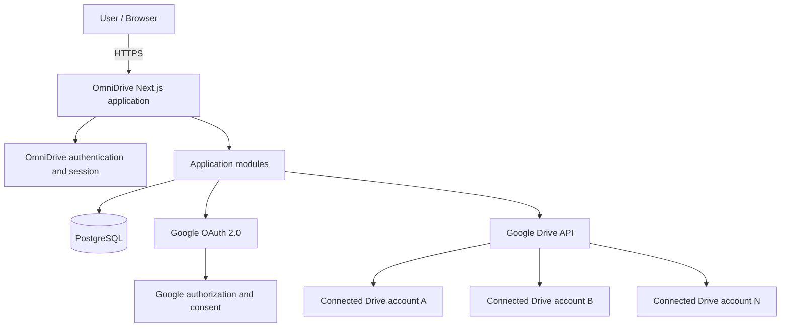
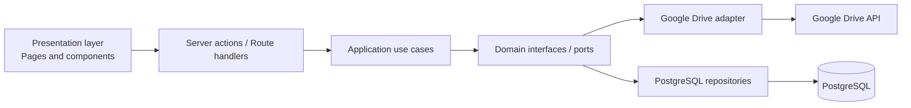

# OmniDrive — Overall System Architecture

> **Status:** Architecture documented; initial UI scaffold committed; provider integration and security enforcement are not implemented yet  
> **Document type:** High-level architecture (HLA) and foundational engineering decisions  
> **Repository:** `harshkumar07/OmniDrive`  
> **Last updated:** 2026-10-11

## 1. Product vision

OmniDrive is a web application that gives a user one place to connect, browse, search, and manage files across multiple Google Drive accounts. Instead of repeatedly switching Google accounts, a user can see connected accounts in one interface and understand which account owns each file.

OmniDrive is an **account aggregation and management layer**, not a new storage provider. Files remain in the Google Drive account where they are stored. The application stores account connections, preferences, and limited file metadata needed for its features; it does not store users' Drive files in its own database or copy all Drive content to another cloud by default.

### Product principles

1. **One interface, multiple independent accounts.** A user may connect or disconnect accounts without a hard-coded account-count limit in OmniDrive.
2. **Clear ownership.** Every file row must identify the Google account that owns the file and every operation must target that account explicitly.
3. **No artificial quota pooling.** OmniDrive may summarize reported quota information across connected accounts for convenience, but this is a dashboard metric—not a merged Google quota or a guarantee that any one upload can use the total. Do not implement account sharding or file splitting to circumvent Google storage limits, quotas, or policies.
4. **Least privilege.** Request only the Google OAuth scopes required for a feature, explain why they are needed, and verify Google's current scope classification and verification requirements before launch.
5. **Private by default / deny by default.** A user can access only their own connected accounts and files unless an explicit, validated sharing grant exists. No implicit sharing between users.
6. **Explicit, narrow sharing only.** If sharing is added later, the owner must select the exact file or folder and the recipient, choose the minimum allowed actions, confirm the grant, and be able to revoke it. Sharing is out of scope for the MVP.
7. **Security by default.** OAuth tokens are server-side secrets, encrypted at rest, never returned to the browser, and never written to logs.
8. **Start simple, preserve seams.** Begin with a modular monolith. Separate modules by responsibility, not by deploying microservices prematurely.
9. **Graceful degradation.** If one connected account is unavailable, the rest of the dashboard should continue to work and report the affected account's state.

## 2. Scope and boundaries

### In scope

- Application sign-in and user sessions.
- Connecting multiple Google Drive accounts to one OmniDrive user.
- Showing connection status and account identity.
- Browsing and searching files across connected accounts, within the permissions and API scopes granted.
- Showing per-account storage/quota information when Google exposes it for the granted scope.
- Uploading a file to a user-selected account when supported by the granted permissions.
- Opening files in Google Drive and, where authorized, downloading or managing them.
- Account disconnection, token revocation/deletion, error handling, audit-safe operational logs, and basic usage limits.
- Strict per-user data isolation and default-deny authorization from the first release.

### Explicitly out of scope for the initial version

- Combining separate Google quotas into a single Google quota.
- Automatically distributing, splitting, or sharding files among accounts to evade storage limits or Google API restrictions.
- Hosting a duplicate copy of every user's Drive files in OmniDrive.
- File/folder sharing between OmniDrive users, shared/team drives, enterprise administration, Dropbox/OneDrive integrations, desktop sync, and mobile-native apps until separately designed. Sharing must have its own threat model and explicit authorization design before implementation.
- Microservices, Kubernetes, message brokers, and a dedicated search cluster before real usage justifies them.

## 3. Recommended technology stack

| Area | Choice | Reason |
|---|---|---|
| Web application | Next.js App Router + TypeScript | One TypeScript codebase for UI and server-side routes, good ecosystem, straightforward deployment |
| UI | React, Tailwind CSS, shadcn/ui | Accessible, reusable dashboard and file-browser components |
| Validation | Zod | Shared, explicit validation for request payloads and environment configuration |
| Google integration | Official Google APIs Node.js client (`googleapis`) | OAuth 2.0 and Drive API support |
| Database | PostgreSQL | Durable relational data, constraints, transactions, and good managed-hosting options |
| Database access | Drizzle ORM + migrations | Typed queries and explicit schema/migration ownership |
| Application authentication | Auth.js or a small, well-defined server-side session layer | Secure OmniDrive user identity; keep app login distinct from Drive account connections |
| Rate limiting | Database-backed or hosting-supported limiter initially | Protect endpoints and prevent accidental API abuse; upgrade if needed |
| Tests | Vitest, React Testing Library, and Playwright | Unit, component, and end-to-end coverage |
| Hosting (initial) | Vercel for Next.js + managed PostgreSQL | Low-friction initial deployment; local development remains possible at no cost |
| Observability | Structured server logs and provider-neutral error reporting | Diagnose failures without leaking tokens or file contents |

**Runtime policy:** Use a currently supported Node.js LTS release supported by Next.js and the chosen host. Pin package versions and commit the lockfile. Do not rely on a floating runtime version in production.

**Do not add Redis, a queue, a separate API server, or microservices in the first iteration.** Add them only when a concrete requirement exceeds the modular monolith's capabilities.

## 4. System context



The browser talks only to OmniDrive. The server calls Google APIs using the credentials belonging to the specific connected account. The browser never receives Google refresh tokens or client secrets.

## 5. Logical architecture

Use a **modular monolith**: one deployable Next.js application, organized into modules with explicit responsibilities and dependency direction.



### Module responsibilities

- **Presentation:** Pages, layouts, forms, loading states, empty states, and account/file components. It must not call Google APIs directly from the browser.
- **HTTP boundary:** Route handlers validate input, authenticate the request, enforce authorization, call a use case, and map errors to stable response shapes.
- **Application/use cases:** Orchestrate operations such as connect account, refresh quota, list files, search files, upload file, disconnect account, and reconcile connection state.
- **Domain:** Core entities, invariants, provider-neutral types, error categories, and interfaces. Keep it independent of Next.js request objects and Google SDK response types.
- **Google Drive adapter:** OAuth exchange/refresh, scope handling, provider API calls, pagination, retry policy, and mapping Google responses into internal DTOs.
- **Persistence:** Drizzle schema, migrations, transactions, repositories, and encrypted-token persistence.
- **Security/operations:** Session checks, ownership checks, CSRF/origin protections where relevant, rate limiting, structured redacted logs, and configuration validation.

### Dependency rules

1. UI components do not access the database or Google SDK.
2. Route handlers do not contain provider-specific business logic.
3. Application use cases depend on interfaces, not directly on Drizzle or raw Google API responses.
4. Google-specific IDs and response shapes stay inside the adapter or explicit provider DTOs.
5. Every account-scoped operation verifies that the connected account belongs to the authenticated OmniDrive user.
6. Secrets are read only by server-side modules.

## 6. Authentication and Google account connection model

OmniDrive has two related but distinct concepts:

- **OmniDrive identity:** Who is signed into the application.
- **Connected Google account:** Which Google Drive identity OmniDrive has permission to access.

A Google identity used to sign in to OmniDrive must not implicitly grant access to every other Google account. Each Drive account connection requires its own explicit authorization flow.

### Connect-account flow

1. The user signs into OmniDrive.
2. The user selects **Connect Google Drive**.
3. The server creates a cryptographically random, short-lived OAuth state value, binds it to the current user/session, and uses PKCE where supported by the chosen OAuth flow.
4. The browser is redirected to Google's authorization endpoint with the configured client ID, exact redirect URI, requested scopes, state, and appropriate offline-access parameters when refresh access is required.
5. Google redirects to the registered callback.
6. The server validates state, checks expiry and one-time use, handles OAuth errors, and exchanges the authorization code server-side.
7. The server obtains the authorized Google account identity and stores a new connection associated with the current OmniDrive user. It must not silently replace another connection merely because two accounts share a display name.
8. Tokens are encrypted before persistence. The server stores the granted scopes, token expiry, provider account identifier, and connection status.
9. The UI displays the new connection and its status.

Use the stable Google subject/account identifier as the provider identity key—not the email address alone. Email is useful display metadata and may change.

### Token lifecycle

- Access tokens are short-lived and should be refreshed server-side when necessary.
- Refresh tokens are sensitive long-lived credentials. Encrypt them with authenticated encryption using a key supplied through deployment secrets or a managed key service; do not store the encryption key in the same database.
- Never place access or refresh tokens in client components, browser local storage, URLs, analytics, error messages, or logs.
- Handle revoked consent, invalid grants, missing refresh tokens, and account removal as explicit connection states.
- Do not assume every OAuth response contains a refresh token. Reconnection may be required.
- Disconnecting an account should revoke provider access when appropriate and supported, then remove or securely invalidate local tokens and related cached metadata according to the documented retention policy.
- Rotate encryption keys using a planned re-encryption procedure. Do not change the key without a migration plan for existing ciphertext.

### OAuth scope strategy

Google Drive scopes have different access levels and may trigger different verification or security-assessment requirements. Decide scopes feature-by-feature rather than requesting broad access at the start.

- Start with the narrowest scope that supports the first feature.
- Understand that a scope limited to files created/opened with the app may not allow listing every pre-existing Drive file.
- Broad read or write access to a user's Drive may be classified as sensitive or restricted and can require additional verification, disclosures, or security assessment depending on the final app and data handling.
- Before public release, review Google's current OAuth consent-screen, scope, verification, data-use, and API Services User Data Policy requirements. Do not promise that a public multi-user app can use broad Drive access without review.
- Store the granted scopes for each connection and disable UI operations that the connection is not authorized to perform.

## 7. Core data model

Use UUID primary keys for OmniDrive-owned records. Google IDs are external identifiers and should be stored as strings. Never use a Google email address as the sole ownership or uniqueness key.

### Main entities

**users**
- `id` (UUID, primary key)
- `email` (normalized display/login email as appropriate)
- `display_name`
- `created_at`, `updated_at`

**sessions / auth accounts**
- Managed by the selected authentication library/adapter.
- Must support secure, revocable sessions and appropriate cookie settings.
- Keep application login credentials distinct from connected Drive credentials.

**connected_accounts**
- `id` (UUID, primary key)
- `user_id` (FK to users)
- `provider` (initially `google_drive`)
- `provider_account_id` (stable Google subject/account ID)
- `email` and `display_name` (display metadata)
- `encrypted_access_token` (nullable if not persisted or not needed)
- `encrypted_refresh_token`
- `access_token_expires_at`
- `granted_scopes` (text array or normalized representation)
- `status` (connected, reauth_required, revoked, error, disconnecting)
- `last_successful_sync_at`, `last_error_code`, `created_at`, `updated_at`
- Unique constraint on `(user_id, provider, provider_account_id)`

**file_metadata_cache**
- `id` (UUID, primary key)
- `user_id` (FK)
- `connected_account_id` (FK)
- `provider_file_id` (Google file ID)
- `name`, `mime_type`, `size_bytes` (nullable), `modified_time`, `web_view_link` (only when useful and permitted)
- `trashed` / state where needed
- `cached_at`, `provider_version_or_etag` where available
- Unique constraint on `(connected_account_id, provider_file_id)`

Cache only metadata required for the product. Treat provider links and metadata as user data; do not expose them across users. Avoid storing file content or thumbnail bytes in the database.

**storage_snapshots**
- `id` (UUID)
- `connected_account_id` (FK)
- `reported_usage_bytes`, `reported_limit_bytes` (nullable when unavailable)
- `captured_at`, `source_status`
- Use snapshots for history/visualization only if the product needs it. Clearly show unknown or stale data instead of inventing values.

**oauth_states** (or equivalent short-lived server-side state storage)
- Store a hashed state/nonce identifier, user/session binding, expiry, and consumed timestamp.
- Expire and delete old records. Never treat an unvalidated callback as authorization.

### Data integrity and privacy

- Add indexes for user ownership and common lookups: `connected_accounts(user_id, status)`, `file_metadata_cache(connected_account_id, modified_time)`, and `file_metadata_cache(connected_account_id, name)` as workload warrants.
- Use foreign keys and transactions for connection changes.
- Enforce account ownership in the application layer and, if practical, PostgreSQL row-level security as defense in depth.
- Set retention rules for cached metadata, failed connections, and audit events.
- Do not log access tokens, refresh tokens, OAuth authorization codes, file contents, or unnecessary personal data.

## 8. API and use-case boundaries

Use versioned, server-side endpoints or server actions with the same security requirements. If using route handlers, a possible initial API shape is:

| Method | Route | Purpose |
|---|---|---|
| GET | `/api/accounts` | List the current user's connected accounts and status |
| POST | `/api/accounts/google/connect` | Start a new Google connection |
| GET | `/api/oauth/google/callback` | Validate and complete the OAuth callback |
| POST | `/api/accounts/:accountId/reconnect` | Start reauthorization for one connection |
| DELETE | `/api/accounts/:accountId` | Disconnect one account |
| GET | `/api/accounts/:accountId/quota` | Retrieve/refresh quota information if supported |
| GET | `/api/files` | List files across selected connected accounts with pagination |
| GET | `/api/accounts/:accountId/files` | List files from one account |
| GET | `/api/accounts/:accountId/files/:fileId` | Fetch authorized metadata for a file |
| POST | `/api/accounts/:accountId/uploads` | Upload to the explicitly selected account, when authorized |
| GET | `/api/health` | Minimal service health status without secrets |

These are proposed contracts, not implemented routes. Use consistent validation, response types, and error mapping. Never accept a `userId` from the browser as proof of identity. Derive the user from the validated session.

### Cross-account listing

- The application starts one paginated listing per connected account, subject to provider limits and selected filters.
- Each returned file includes an OmniDrive account reference so the UI can identify its source.
- Use bounded concurrency rather than launching unlimited parallel requests.
- A failure for one account should produce a partial result with an account-level warning where feasible; it should not erase successful results from other accounts.
- Use stable cursors and per-account pagination state. Do not pretend that separate Google Drive result sets form one globally ordered, consistent database query.
- Apply sorting and filtering carefully. If combining pages from several accounts, document whether sort order is approximate until enough pages have been fetched.
- Cache metadata only where it improves UX and respects API policy; define expiry and invalidation behavior.

### Upload behavior

- The user explicitly selects the destination connected account.
- Before upload, verify account ownership, connection status, required scopes, file size limits, and provider-supported behavior.
- Stream file data where possible rather than buffering large files entirely in memory.
- Enforce upload limits and timeouts; handle cancellation, network interruption, and ambiguous provider outcomes.
- Show the destination account and upload result. Do not automatically shard, split, or spread files across accounts to bypass quota or policy limits.

## 9. Storage dashboard semantics

The dashboard may show:
- Each connected account's reported storage usage and limit, where the Drive API returns them for the granted authorization.
- The timestamp when the information was last refreshed.
- A sum of known per-account figures for overview purposes, with unavailable values clearly marked.
- Per-account warnings such as reauthorization required, quota unavailable, or stale information.

The UI must not label the sum as a single Google Drive quota. Google accounts remain separate; Google may count Gmail, Drive, and Photos against the same account-level Google storage allowance. A displayed aggregate is informational only and must not imply that a single account can upload against another account's free space.

## 10. Failure handling and resilience

Create a small, typed internal error model, for example:
- `AUTH_REQUIRED`
- `ACCOUNT_REAUTH_REQUIRED`
- `INSUFFICIENT_SCOPE`
- `PROVIDER_RATE_LIMITED`
- `PROVIDER_UNAVAILABLE`
- `FILE_NOT_FOUND_OR_NO_ACCESS`
- `UPLOAD_TOO_LARGE`
- `VALIDATION_FAILED`
- `INTERNAL_ERROR`

Map provider errors to safe user-facing messages. Keep raw provider payloads out of client responses and redact them in logs.

- Respect Google API rate-limit responses and retry guidance.
- Retry transient failures with bounded exponential backoff and jitter where retrying is safe.
- Do not blindly retry non-idempotent uploads after an uncertain outcome; reconcile provider state or ask the user to retry.
- Use per-account concurrency limits so one account cannot starve the rest.
- Add request timeouts and cancellation.
- If Google is unavailable, show cached metadata with a visible stale indicator only if that cache is safe and still useful.
- Avoid a background queue until long-running sync or retry workloads make one necessary.

## 11. Security model

### Trust boundaries

1. Browser: untrusted; all submitted identifiers and values require validation.
2. OmniDrive server: trusted application boundary, but still validates every request and applies ownership checks.
3. PostgreSQL: stores user data and encrypted credentials; restrict network and credentials.
4. Google OAuth/API: external provider; validate callbacks and handle provider failures.
5. Deployment platform: secrets and runtime configuration must be protected through its secret-management facilities.

### Required controls

- HTTPS in production.
- Secure, HttpOnly, appropriately SameSite session cookies.
- CSRF/state protections for OAuth and state-changing actions.
- Exact OAuth redirect URI registration and strict callback validation.
- Server-side token encryption and secret management.
- Authentication plus resource-level authorization on every account/file endpoint.
- Deny-by-default isolation: each database query is scoped to the authenticated owner; IDs and URLs are never authorization.
- No sharing in the MVP. Any future share requires an explicit owner action, a verified recipient, narrow permissions, expiry/revocation support, and checks against Google Drive's own permissions.
- Rate limits for login, connection, search, quota refresh, and uploads.
- Input validation, safe file-name handling, and safe rendering of metadata.
- Security headers and a restrictive Content Security Policy where compatible.
- Dependency updates, lockfile, and secret scanning.
- Redacted structured logging; never log tokens, auth codes, raw cookie values, or file contents.
- A clear disconnect/delete path and privacy notice before public launch.

### Multi-tenant isolation

Even if the first release is for one person, structure records around `users` and enforce ownership checks from day one. Every query involving a connected account must scope by the current user. Use opaque IDs for URLs, but remember that unguessable IDs are not authorization.

**Authorization invariant:** for a resource request, access is allowed only if the authenticated user owns the connected account/resource, or a deliberately implemented and valid share grant authorizes the exact recipient, resource, and action—and Google Drive itself also permits the operation. Otherwise deny. The MVP implements only the owner path. Test this invariant with two distinct users and two distinct sets of Google accounts/files, including guessed IDs and cross-user requests.


### Private-by-default authorization and future sharing

**Default rule: no explicit grant means no access.** The MVP has no user-to-user sharing feature. A signed-in user can access only connected accounts owned by their OmniDrive user ID. A connected Google account is not a public resource, and connecting it does not grant access to other OmniDrive users, collaborators, administrators, or anyone who knows a link.

For every request involving an account, file, folder, download, upload, search result, thumbnail, quota, or cached metadata:

1. Authenticate the caller using a validated server-side session.
2. Load the resource from the database using both its identifier and the caller's authorized ownership scope; do not fetch globally by ID and assume the ID is secret.
3. Verify the connected account belongs to the caller, or—only if sharing is deliberately implemented in a future phase—verify a valid, unexpired, non-revoked share grant for that exact resource and requested action.
4. Check the granted Google OAuth scopes and the actual Google Drive permissions. OmniDrive must never treat its own share record as a way to bypass Google's authorization.
5. Return only the minimum data needed. Do not leak another user's file names, account emails, existence of private resources, provider IDs, error details, or cached metadata.
6. Record security-relevant actions without logging tokens, file contents, or unnecessary personal information.

Use deny-by-default authorization. Missing ownership, a missing share grant, a revoked grant, an expired grant, insufficient scope, or a failed authorization check must deny the operation. Prefer a generic not-found response for resources the caller is not allowed to discover, to reduce resource enumeration.

**If sharing is added later**, require an explicit flow in which the owner:
- Selects one exact file or folder from an account they own.
- Selects a verified recipient identity; never accepts a recipient email or user ID as proof that the caller may share with that person.
- Chooses a limited role such as viewer or editor, with the allowed actions defined centrally.
- Reviews and confirms the permission before the grant is created.
- Can see active grants, revoke a grant, and understand whether revocation applies to descendants of a shared folder.
- Receives a clear explanation if access must also be granted or revoked in Google Drive itself.

A future `resource_shares` table should store the owner user ID, recipient user ID, resource type, connected account ID, provider file/folder ID, allowed role/actions, created-by user ID, creation/expiry/revocation timestamps, and audit metadata. Add foreign keys and indexes. Do not create this table or expose sharing endpoints until the sharing feature is approved and designed.

Folder sharing needs particular care: access to a folder may imply access to descendants, and Google Drive may have inherited or pre-existing permissions. The app must not assume a folder share is equivalent to a single-file share. Before exposing a shared item, verify both OmniDrive's grant and Google Drive's effective permissions. If those cannot be reconciled safely, deny access.

**Never implement** public-by-default file links, a global “anyone can access” mode, implicit sharing just because users know each other, or use of the owner's OAuth token on behalf of a recipient without an explicit authorized flow. A share in OmniDrive must not silently change Google Drive's native sharing settings. Native Google Drive permission changes, if ever supported, must be a separate clearly disclosed action requiring the owner's authorization.

## 12. Performance and scale

Optimize based on measured bottlenecks, not hypothetical scale.

- Fetch only the fields needed from Google Drive.
- Use pagination for file lists.
- Limit parallel provider requests.
- Cache small, non-sensitive derived information and quota snapshots with explicit freshness.
- Use PostgreSQL indexes based on observed query patterns.
- Keep file bytes out of application memory where possible and use streaming.
- Add background jobs only when the user experience requires long-running synchronization.
- If later required, move sync jobs to a worker and durable queue while keeping the same application/domain interfaces.

A growing number of connected accounts is supported by database records and runtime iteration—not by adding columns such as `account1`, `account2`, or `account3`. The actual practical limits are Google OAuth/API quotas, provider terms, server capacity, and UX constraints; the app must report these honestly.

## 13. Suggested repository structure

Start with a single Next.js application. Avoid a monorepo until a separate deployable service or shared package actually exists.

```text
omni-drive/
├── docs/
│   ├── ARCHITECTURE.md
│   ├── SECURITY.md                 # add before external beta
│   └── GOOGLE_OAUTH_SETUP.md       # add with OAuth implementation
├── public/
├── src/
│   ├── app/
│   │   ├── (marketing)/
│   │   ├── (app)/
│   │   │   ├── dashboard/
│   │   │   ├── files/
│   │   │   └── settings/
│   │   ├── api/
│   │   │   ├── accounts/
│   │   │   ├── files/
│   │   │   └── oauth/google/callback/
│   │   ├── layout.tsx
│   │   └── globals.css
│   ├── components/
│   │   ├── ui/
│   │   ├── layout/
│   │   ├── accounts/
│   │   ├── files/
│   │   └── storage/
│   ├── modules/
│   │   ├── auth/
│   │   ├── connected-accounts/
│   │   ├── drive-files/
│   │   └── storage/
│   ├── server/
│   │   ├── config/
│   │   ├── db/
│   │   │   ├── schema/
│   │   │   ├── migrations/
│   │   │   └── client.ts
│   │   ├── google/
│   │   │   ├── oauth-client.ts
│   │   │   ├── drive-client.ts
│   │   │   └── mappers.ts
│   │   ├── security/
│   │   │   ├── token-encryption.ts
│   │   │   ├── authorization.ts
│   │   │   └── rate-limit.ts
│   │   └── observability/
│   ├── lib/
│   │   ├── validation/
│   │   ├── errors/
│   │   └── utils/
│   └── types/
├── tests/
│   ├── unit/
│   ├── integration/
│   └── e2e/
├── drizzle.config.ts
├── next.config.ts
├── package.json
├── pnpm-lock.yaml
├── tsconfig.json
├── .env.example
├── .gitignore
└── README.md
```

This is a target structure. Create directories when the corresponding code exists; do not create empty layers solely to match the diagram. Keep modules cohesive and avoid circular dependencies.

## 14. Configuration and secrets

Use environment variables locally and the deployment platform's secret manager in production. Validate required variables at startup.

Expected configuration categories:
- Application base URL and environment.
- PostgreSQL connection string.
- Session/authentication secret.
- Google OAuth client ID and client secret.
- Exact Google OAuth callback URL.
- Token-encryption key or managed-key configuration.
- Optional logging/error-reporting settings.

Commit an `.env.example` containing placeholder names only. Never commit `.env`, client secrets, token ciphertext copied from production, private keys, or real user data. Use different OAuth clients and databases for development and production where practical.

## 15. Testing strategy

- **Unit tests:** domain rules, scope checks, error mapping, quota aggregation display logic, pagination helpers, and token-encryption wrappers.
- **Integration tests:** repositories, migrations, ownership filters, token persistence, and Google adapter behavior using mocked provider responses.
- **OAuth tests:** invalid/missing state, expired state, replayed callback, denied consent, missing refresh token, revoked access, and mismatched account.
- **API tests:** unauthenticated requests, cross-user account IDs, cross-user file IDs, guessed URLs, invalid payloads, rate limits, and safe error responses.
- **Isolation tests:** User A must not list, search, preview, download, upload into, or retrieve metadata for User B's accounts/files. Test both direct-ID access and identifiers copied from another session. All must fail unless a future explicit share grant is valid.
- **End-to-end tests:** sign-in, connect-account UI with mocked OAuth callback, account list, file browsing, account disconnect, and partial provider failure.
- **Manual Google test:** use a dedicated test account and explicit test data; never use production credentials in automated test logs.
- **Security tests:** ensure no token is returned in API JSON, HTML, client bundles, URLs, or logs.

CI should run formatting/linting, type checking, unit/integration tests, and a production build. Deployment should not require production OAuth credentials in pull-request builds.

## 16. Deployment architecture

### Initial deployment

- **Web/server:** one Next.js deployment on Vercel.
- **Database:** managed PostgreSQL with TLS, backups, and a least-privilege application role.
- **Google OAuth:** configured in Google Cloud Console with exact origins, redirect URIs, consent-screen details, and only the scopes currently required.
- **Secrets:** Vercel environment variables or a managed secret store; different values per environment.
- **Migrations:** run as a controlled deployment step using a migration command; do not let every server instance race to apply schema migrations at runtime.

Verify hosting runtime limits before implementing large uploads or long-running sync. If deployment constraints make streaming or durable background processing unsuitable, move those responsibilities to a dedicated worker or service only when required.

### Environments

- **Local:** local PostgreSQL, test Google OAuth client, localhost callback.
- **Preview:** isolated preview configuration; never expose production refresh tokens to preview deployments.
- **Production:** production OAuth client, production database, secure cookies, restricted secrets, backups, monitoring, and reviewed privacy disclosures.

## 17. Delivery plan

### Phase 0 — Architecture and setup
- Commit this architecture document.
- Scaffold Next.js, TypeScript, Tailwind, linting, formatting, and tests.
- Add validated configuration and local PostgreSQL/Drizzle migrations.
- Add a basic dashboard with mock account data.

### Phase 1 — Application identity and security baseline
- Implement app sign-in and protected routes.
- Add session handling, ownership helpers, security headers, and redacted logging.
- Create database tables and tests for users and connected accounts.

### Phase 2 — One Google Drive connection
- Configure Google Cloud OAuth for local development.
- Implement state validation, callback handling, token encryption, and account identity retrieval.
- Connect one test account and show connection status.
- Confirm scope and verification requirements before enabling broad Drive access.

### Phase 3 — Multiple account connections
- Support adding multiple distinct Google accounts to one OmniDrive user.
- Implement per-account reconnect and disconnect.
- Handle duplicate connections and revoked authorization safely.
- Test with multiple dedicated Google test accounts.

### Phase 4 — Browse, search, and storage overview
- Implement paginated file listing and cross-account aggregation.
- Label each file with its source account.
- Show partial failures and stale quota information accurately.
- Add bounded concurrency, caching, and rate-limit handling.

### Phase 5 — Explicit destination uploads
- Implement upload to a user-selected account using only supported and authorized operations.
- Stream data, enforce limits, handle cancellation, and reconcile uncertain outcomes.
- Do not implement quota-evasion sharding or automatic file splitting across accounts.

### Phase 6 — Hardening and release
- Complete security, integration, and end-to-end tests.
- Add privacy/retention documentation and account-data deletion.
- Review Google's current OAuth verification and user-data policy requirements.
- Deploy with backups, monitoring, and a rollback procedure.

## 18. Architecture decisions and alternatives

### Why a modular monolith?
It gives one developer a clean separation of concerns without operational overhead. A worker or service can be extracted later behind stable interfaces if usage proves it necessary.

### Why Next.js rather than separate React and API projects?
The initial product has one web UI and a relatively focused server integration. One application reduces deployment and local-development complexity. If the API later serves multiple clients or needs independent scaling, it can be extracted without changing domain rules.

### Why PostgreSQL?
Account ownership, sessions, connection states, token records, and metadata benefit from relational constraints and transactions. The app does not need a document database just because it manages files.

### Why no file-storage bucket initially?
Google Drive remains the source of truth. A second storage system would add cost, privacy responsibilities, deletion complexity, and confusion about where the user's files live.

### Why no background queue initially?
The MVP can perform bounded, request-driven operations. Add a durable queue for scheduled synchronization or lengthy jobs only when those are real requirements.

## 19. Key risks and mitigations

| Risk | Mitigation |
|---|---|
| Google OAuth verification or scope restrictions | Begin with minimal scopes; verify requirements before public launch |
| Refresh token theft | Server-only storage, authenticated encryption, managed encryption key, redacted logs |
| One user's account/file accessed by another | Deny-by-default ownership checks on every request, scoped database queries, no ID-based trust, cross-user isolation tests |
| Accidental or over-broad sharing | No sharing in MVP; future explicit recipient/resource/action grants, revocation, and Google permission checks |
| API quotas and rate limits | Bounded concurrency, pagination, backoff, cache, account-level error states |
| Confusing aggregate quota with one quota | Label aggregate as informational and keep every operation tied to one account |
| Provider outage | Partial results, stale indicators, graceful account-level failures |
| Large upload memory/timeouts | Streaming, explicit size limits, cancellation, deployment-runtime review |
| Data retention/privacy obligations | Minimize metadata, define deletion and retention rules, provide clear disclosures |

## 20. Definition of done for the architecture baseline

Before significant feature development, the repository should have:

- [ ] This architecture document reviewed and committed.
- [ ] A documented product boundary: unified management, not quota circumvention.
- [ ] Stack and dependency versions pinned.
- [ ] A running local Next.js application.
- [ ] PostgreSQL and migration workflow working locally.
- [ ] Validated environment configuration and a safe `.env.example`.
- [ ] No real credentials committed.
- [ ] A documented OAuth scope decision for the first Google Drive feature.
- [ ] Tests that enforce user/account/file ownership boundaries and reject cross-user access.
- [ ] Default-deny policy documented: no explicit, validated share grant means no access.
- [ ] Sharing is excluded from the MVP unless a separate threat model and permission design are approved.
- [ ] A phased implementation plan tracked as issues or milestones.

---

## References to verify during implementation

Use official documentation and re-check it before public release, because APIs, supported runtimes, OAuth requirements, and policy language can change.

- Next.js documentation: https://nextjs.org/docs
- Google Drive API: https://developers.google.com/drive/api/guides/about-sdk
- Google OAuth 2.0: https://developers.google.com/identity/protocols/oauth2
- Google OAuth verification: https://support.google.com/cloud/answer/9110914
- Google API Services User Data Policy: https://developers.google.com/terms/api-services-user-data-policy
- Drizzle ORM: https://orm.drizzle.team/docs/overview
- PostgreSQL documentation: https://www.postgresql.org/docs/
- Auth.js documentation: https://authjs.dev/


## Engineering Standards: Clean, Reusable, Production-Ready Architecture

These standards are the default for implementation work in OmniDrive. They describe the intended architecture; a documented rule is not evidence that the corresponding control has already been implemented.

### 1. Architecture approach

Start with a **modular monolith**, not microservices. Keep deployable complexity low while enforcing clear module boundaries. Organize by business capability (identity, connected drives, files, storage, sharing) and use the same request-processing pattern within each backend module.

A typical backend flow is:

`HTTP route handler → input/schema validation → application use case → domain rules → repository/provider interface → infrastructure adapter`

- **Route handlers/controllers:** HTTP concerns only—parse and validate input, authenticate, invoke a use case, and translate its result to an HTTP response. Do not put business rules or SQL/Google API calls here.
- **Application/use-case layer:** Orchestrates a user goal, such as connecting a Drive account or listing files. Owns transaction boundaries and coordinates domain logic and ports.
- **Domain layer:** Holds business rules and domain types. It must not depend on Next.js, the database driver, or Google SDK types.
- **Infrastructure layer:** Implements database repositories, Google Drive/OAuth clients, token encryption, logging, and other external integrations behind narrow interfaces.
- **Composition boundary:** Wire concrete implementations in one clearly defined server-only location. Never import server infrastructure into client components.

Keep this as a small, understandable structure; do not create interfaces or abstractions that have no real seam, reuse, or testing benefit.

### 2. Frontend: keep UI separate from business logic

Use feature-oriented modules so related screens, hooks, schemas, and API contracts are easy to find. For example:

```text
src/
  features/
    drives/
      components/       # presentation-only components
      hooks/            # UI state and lifecycle coordination
      services/         # client-side use-case/API orchestration
      schemas/          # request/response validation and types
    files/
    storage/
  components/           # shared, generic UI components
  lib/
    api/                 # shared HTTP client and response parsing
    errors/              # client-safe error types/mapping
```

- Components render props/state and emit user intent. They should not contain authorization rules, provider API calls, storage calculations, or large workflows.
- Put reusable UI state and lifecycle coordination in custom hooks. Put API calls in a shared typed API client and feature-specific service functions; avoid duplicating fetch/error/JSON parsing in components.
- Keep **business rules on the server as the source of truth**. Frontend validation is for usability and must never replace server-side validation or authorization.
- Define explicit TypeScript request/response types and validate untrusted network data at boundaries. Do not treat a TypeScript type alone as runtime validation.
- Keep loading, empty, success, partial-success, and error states explicit. Retry only safe/idempotent operations, and avoid infinite retry loops.
- Use React error boundaries for unexpected rendering failures. They do not replace handling errors from event handlers, requests, or server actions.
- Shared components should be generic and reusable; feature-specific workflows should remain in the feature module rather than a giant all-purpose component.

### 3. Backend: one consistent use-case pattern

Each feature should follow the same structure, adapted only when complexity warrants it:

```text
src/server/
  modules/
    drives/
      drives.routes.ts       # HTTP adapter
      drives.schemas.ts      # boundary validation
      connect-drive.ts       # application use case
      drive-policy.ts        # domain rules
      drive.repository.ts    # repository port/interface
      google-drive.adapter.ts# provider adapter
```

The names are illustrative, not a requirement to create every file immediately.

- Use explicit DTOs; never expose database rows or Google API responses directly as public API contracts.
- Validate route params, query strings, request bodies, pagination limits, and provider responses at boundaries.
- Keep persistence behind repositories. Keep Google-specific API details behind provider adapters, translating provider errors into application-level errors.
- Inject dependencies into use cases so they can be unit-tested without a live database or Google account.
- Use database constraints and transactions for invariants that must hold under concurrent requests. Do not rely only on pre-checks in application code.
- Keep functions small and cohesive. Extract a shared helper only when semantics are genuinely shared; do not build a generic framework for a single use.
- Avoid hidden global mutable state. Use stateless request handling where possible and make cache keys include the full authorization scope.

### 4. Standard error handling

Use a small, documented application error vocabulary, for example:

- `VALIDATION_ERROR` — invalid input.
- `UNAUTHENTICATED` — no valid user session.
- `FORBIDDEN` — the authenticated user lacks permission.
- `NOT_FOUND` — resource absent or deliberately concealed to prevent disclosure.
- `CONFLICT` — state transition or uniqueness conflict.
- `RATE_LIMITED` — an operation must be retried later.
- `PROVIDER_UNAVAILABLE` — Google or another dependency is unavailable.
- `INTERNAL_ERROR` — unexpected failure.

Rules:

- Translate low-level database, OAuth, and Google API exceptions at the adapter boundary. Do not leak raw provider errors, SQL, stack traces, token values, or internal paths to clients.
- Convert known application errors into a consistent response shape containing a stable code, safe message, and request/correlation ID. Include field-level validation details only when safe.
- Log unexpected exceptions once at the appropriate boundary with stack trace and correlation ID; avoid logging the same exception at every layer.
- Fail closed for authentication, ownership checks, token decryption, and permission evaluation. Never return data merely because an authorization service failed.
- Treat a connected account failing independently from other accounts as a possible partial-success case. Return per-account success/failure in a documented shape only when safe; never silently present incomplete data as complete.
- Retry only transient failures with bounded exponential backoff and jitter, honoring provider retry hints. Do not automatically retry non-idempotent operations unless they have an idempotency strategy.
- Cancellation and client disconnects should not be reported as unexpected server failures when they are expected control flow.

### 5. Logging, audit, and observability

Use one server-side structured logger interface across modules so logging fields and redaction behavior are consistent. Emit structured JSON in production where supported.

Recommended fields: timestamp, severity, event name, environment, request/correlation ID, route or operation, duration, outcome, stable error code, and a pseudonymous internal user ID when needed for diagnosis.

- Never log OAuth access/refresh tokens, cookies, authorization headers, client secrets, encryption keys, raw file contents, or full sensitive provider payloads.
- Avoid logging file names, email addresses, and search queries by default; they can reveal private information. Add only reviewed, necessary fields and apply redaction.
- Record security-sensitive events—account connected/disconnected, token refresh/revocation failures, permission denials, and sharing-grant changes—as audit events distinct from diagnostic logs. Audit events must not contain credentials.
- Capture latency, error rates, provider rate limits, database failures, token refresh outcomes, and partial-account failures. Add alerts when operational thresholds are defined.
- Do not build a home-grown monitoring platform. Start with platform logs and metrics; integrate an established provider when the operational need is clear.
- Client-side logs must be privacy-conscious and must not include secrets or private file data. Server logs are the source of truth for security investigations.

### 6. Security and multi-account isolation

- Derive the current user exclusively from a validated server-side session. Never trust a client-supplied `userId`, account owner, or authorization flag.
- Scope every connected-account, file-metadata, and sharing-grant query by the authenticated user's ownership or an explicitly validated grant. A resource ID being hard to guess is not authorization.
- Check authorization on every server request, including nested resources, background jobs, downloads, and future sharing endpoints.
- Keep Google tokens server-side and encrypted at rest using a managed secret/key service where available. Never send refresh tokens to the browser.
- Request the minimum OAuth scopes needed for each feature. Validate OAuth state and redirect URIs; use PKCE where applicable and handle revocation and reconnect flows.
- Cache entries must be partitioned by user and connected account. Never use a shared cache key that can return one user's data to another.
- Sharing is opt-in and deny-by-default: no share without an explicit, validated grant for the exact resource and recipient. Do not implement sharing until its policy, revocation, and tests are specified.

### 7. Testing strategy

- **Unit tests:** domain rules, use cases, error translation, storage calculations, pagination, and retry decisions.
- **Adapter/integration tests:** repositories, database constraints, Google API mapping, token lifecycle, and migrations.
- **API tests:** validation, authentication, response contracts, rate limiting, and safe error responses.
- **Isolation/security tests:** User A cannot read, search, download, disconnect, or mutate User B's account or file metadata; guessed IDs and altered request parameters must not bypass ownership checks.
- **Frontend tests:** user-visible loading/empty/error/partial-success states and interaction behavior; keep core business-rule tests out of component tests.
- **End-to-end tests:** connect, list, refresh, disconnect, and reconnect a test account using a safe test environment. Avoid real user data.
- CI should run formatting/lint, type checks, unit tests, integration tests where configured, and a production build. Dependency/security checks should be added and failures reviewed rather than blindly ignored.

### 8. Performance and change management

- Paginate large file lists; avoid loading all provider data into memory. Use bounded concurrency and respect Google API quotas.
- Use database indexes based on actual query patterns and inspect slow queries before adding caching.
- Add caching only with a documented freshness/invalidation policy and authorization-safe keys.
- Prefer cursor pagination when provider ordering and page tokens support it. Treat provider page tokens as opaque.
- Make long-running sync work resumable and idempotent before moving it to background jobs.
- Keep configuration environment-specific and validated at startup. Fail early when required configuration is missing; never commit real secrets.
- Upgrade dependencies deliberately, commit the lockfile, and require CI to pass before promoting a change. Security patches take priority over feature work.
- Document architecture decisions when a choice has meaningful long-term consequences; keep this file actionable rather than collecting arbitrary patterns.

### 9. Definition of done for a feature

A feature is not complete just because its happy path works. Confirm that it has input validation, server-side authorization, consistent error mapping, privacy-safe logs, loading/empty/error states, relevant tests, migration/configuration notes if needed, and a successful CI build. Mark controls as implemented only after code and tests demonstrate them.
